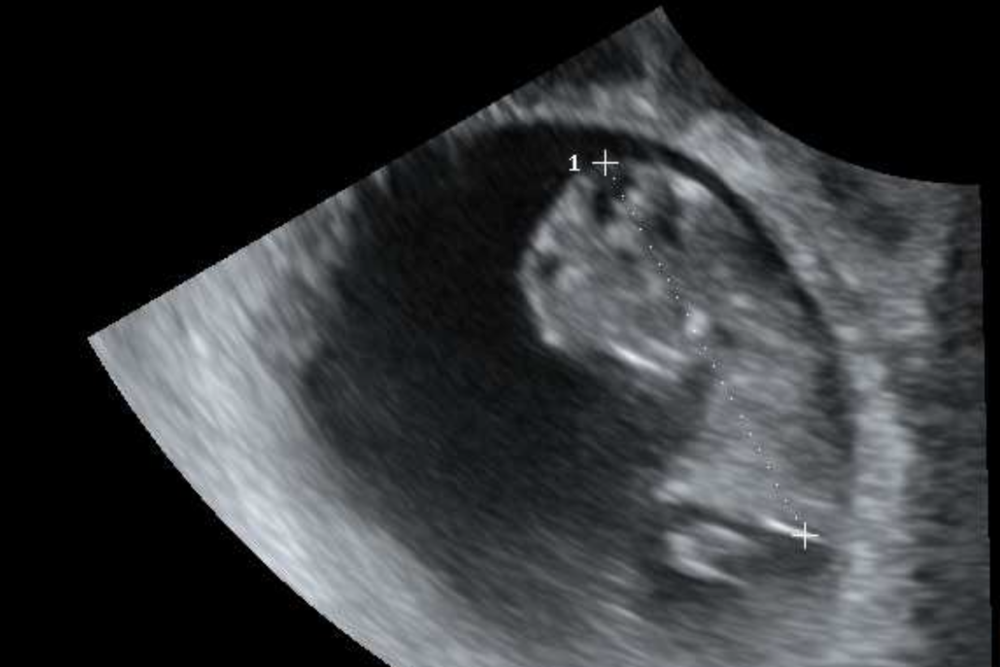
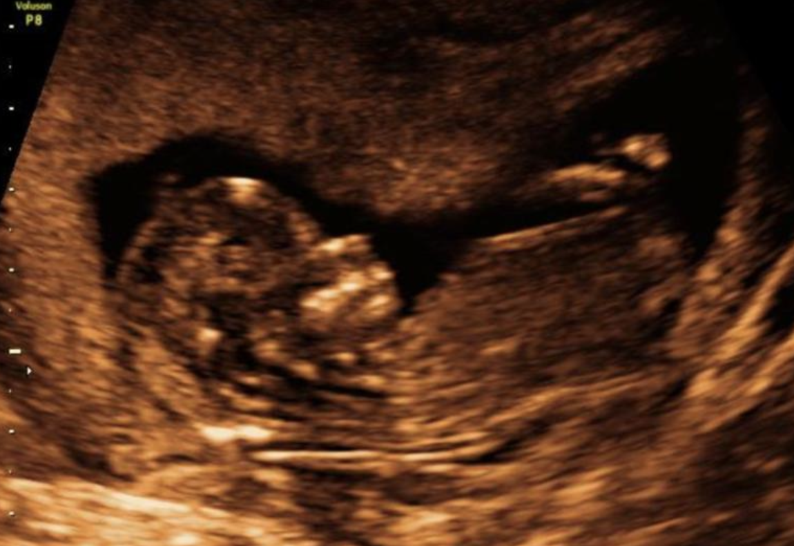

# nano-distill

Distilling two large teacher models into one small student model.

## TL;DR

**We're having a baby.** 👶

The training run started this summer. v1.0 ships in late April 2027.

## Samples

| Checkpoint 1 | Checkpoint 2 |
|:---:|:---:|
|  |  |

## Model card

| | |
|---|---|
| Architecture | Human, v1.0 |
| Teacher models | 2 (that's us) |
| Training data | Love, lots of snacks, ~~sleep~~ |
| Training time | ~40 weeks, single node |
| Parameters | ~3.4 kg at release (est.) |
| Context window | Unlimited, but will need everything explained twice |
| Release | Late April 2027 |
| License | All rights reserved. Hugs are open source. |

## Roadmap

- [x] Start training run
- [x] Heartbeat detected
- [x] First samples
- [ ] Ship v1.0 (late April 2027)
- [ ] Sleep (deprecated, no replacement planned)

## Known issues

- Teacher models report elevated snack throughput. Status: expected behavior.
- Inference will run at 3 a.m. Status: wontfix.

## Contributing

Congratulations, advice and hand-me-downs are welcome. Drop them in [the issues](../../issues). 💛
